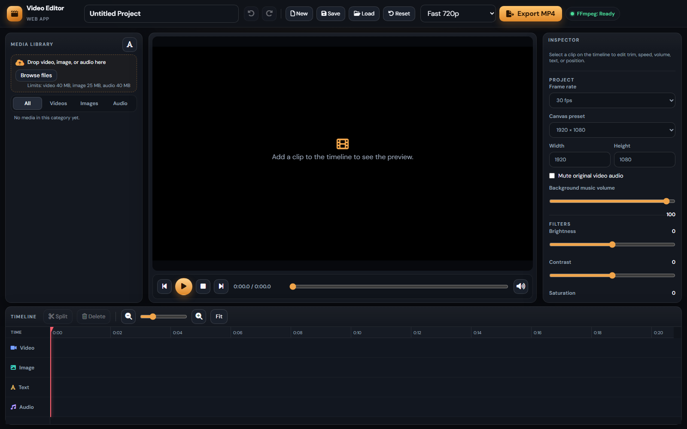
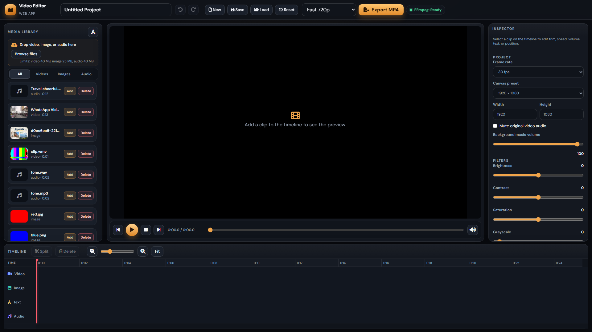

# Web-Based Video Editor

A browser-based video editor for XAMPP. Upload video, images, and audio, arrange them on a timeline, trim and split clips, add text and picture overlays, mix background music, preview the edit, and export an MP4 with FFmpeg.

The project is plain PHP, HTML, CSS, and JavaScript so it can be read and changed without a framework.

## Screenshots





More notes: [docs/README.md](docs/README.md).

## Features

- Media library with drag-and-drop upload, type and size checks, thumbnails, and delete
- Timeline with video, image, text, and audio tracks, zoom, drag, trim, and split
- Inspector for speed, volume, mute, crop, position, scale, rotation, text, and filters
- Live canvas preview with play, pause, stop, seek, and mute
- Undo and redo (50 steps) and project save/load in the browser, plus a JSON download
- Background MP4 export (Fast 720p or High Quality 1080p) with progress and download

## Technologies

- PHP 8.2 or newer (PHP 8.3+ is ideal)
- HTML5, CSS3, vanilla JavaScript
- Bootstrap 5 and Font Awesome from a CDN
- Fetch and `XMLHttpRequest` (upload progress)
- `localStorage` for the open project
- FFmpeg and FFprobe

MySQL is not required. The API stores media as files plus JSON metadata. User accounts and saved projects can be added later with PDO and prepared statements.

## Requirements

- Windows with [XAMPP](https://www.apachefriends.org/) (Apache and PHP)
- PHP 8.2+ with the `fileinfo` extension
- FFmpeg and FFprobe
- A modern desktop browser (Chrome or Edge)
- Enough disk space for uploads and finished MP4 files

Typical local URL after placing the project under your XAMPP `htdocs` folder:

`http://localhost/Web-based_video_editor/`

## XAMPP installation

1. Install XAMPP and start **Apache** from the XAMPP Control Panel.
2. Clone or copy this project into your XAMPP `htdocs` folder (for example `htdocs/Web-based_video_editor`).
3. Confirm PHP from a terminal (`php -v`, or your XAMPP `php.exe -v`).
4. Open `http://localhost/Web-based_video_editor/`. The top bar should show the editor.

## FFmpeg installation

Windows builds are expected in:

```text
bin/ffmpeg.exe
bin/ffprobe.exe
```

A current essentials build is already placed there for this XAMPP machine. The header badge should read **FFmpeg: Ready**.

To install or replace it yourself:

1. Download the Windows essentials build from [https://www.gyan.dev/ffmpeg/builds/](https://www.gyan.dev/ffmpeg/builds/).
2. Copy `ffmpeg.exe` and `ffprobe.exe` from the zip's `bin` folder into this project's `bin` folder.
3. Reload the editor. `api/health.php` reports whether both tools can be found.

On another computer you can instead set full paths in `includes/config.local.php` (copy `includes/config.local.php.example`):

```php
<?php
declare(strict_types=1);

define('FFMPEG_PATH', 'C:/ffmpeg/bin/ffmpeg.exe');
define('FFPROBE_PATH', 'C:/ffmpeg/bin/ffprobe.exe');
```

## FFprobe installation

FFprobe ships in the same FFmpeg package. Keep `ffprobe.exe` next to `ffmpeg.exe`. The editor uses it to read duration, width, height, and whether a file has audio or video. It does not re-encode a file just to read that information.

If the badge says **FFmpeg: Not Available**, video and audio upload and export stop with a clear error. Image uploads can still work.

## Folder permissions

Apache must be able to create and write these folders:

```text
uploads/videos
uploads/images
uploads/audio
uploads/thumbs
uploads/previews
uploads/meta
exports
exports/jobs
logs
```

The application creates them on startup. On Windows with XAMPP they are writable by default. On Linux or cPanel they need `755` or `775`, and the web user must own them.

These locations are blocked from the web:

- `includes/`, `logs/`, `bin/`
- `uploads/meta/` (JSON catalogue)
- `exports/` (download finished MP4 files through `api/download.php`)

`uploads/.htaccess` refuses to execute scripts that were uploaded.

## PHP configuration

Video uploads need limits above the usual XAMPP defaults. In `php.ini` (or cPanel MultiPHP INI), raise values such as:

```ini
max_execution_time = 300
max_input_time = 300
post_max_size = 520M
upload_max_filesize = 512M
memory_limit = 512M
```

Restart Apache after any `php.ini` change. `post_max_size` must stay larger than `upload_max_filesize`.

The app also has its own ceilings in `includes/config.php`:

```php
MAX_VIDEO_SIZE = 512 MB
MAX_IMAGE_SIZE = 25 MB
MAX_AUDIO_SIZE = 80 MB
COMPOSITION_WIDTH = 1920
COMPOSITION_HEIGHT = 1080
COMPOSITION_FPS = 30
```

The effective upload limit is the smaller of the PHP ini value and the config constant.

## Upload limits

| Kind | Extensions | Default max |
| --- | --- | --- |
| Video | mp4, webm, mov, wmv | 512 MB |
| Image | jpg, jpeg, png, webp | 25 MB |
| Audio | mp3, wav, aac, m4a | 80 MB |

The server checks the extension, the detected MIME type, the size, and that the file really arrived as an upload. Original filenames are display text only. Stored names look like `a1b2c3d4e5f60718.mp4`.

WMV and MOV files that a browser cannot play are copied to a smaller MP4 preview. Export still uses the original file.

## How to start the application

1. Start Apache in XAMPP.
2. Open `http://localhost/Web-based_video_editor/`.
3. Confirm **FFmpeg: Ready**.
4. Name the project, upload media, and press **Add** or drag a file onto a timeline track.
5. Use **Save** to store the project in this browser and download a JSON copy. Refreshing the page restores the last local project. **Load** reads a JSON file. **New** and **Reset** start over after you confirm.

## How to export a video

1. Put at least one clip, image, text line, or audio item on the timeline.
2. Choose **Fast 720p** or **High Quality 1080p**.
3. Click **Export MP4**.
4. The browser sends the project JSON, PHP starts FFmpeg in the background, and the page polls `api/export_status.php`.
5. When the status is `done`, click **Download MP4**.

Export encoding:

- Video: H.264 (`libx264`), pixel format `yuv420p`
- Audio: AAC
- `+faststart` so the file can start playing on the web before it fully downloads
- Fast: 1280×720, preset `veryfast`, CRF 26
- High quality: 1920×1080, preset `medium`, CRF 18

If the project aspect ratio is not 16:9, the picture is fitted inside that frame with black bars. The filter graph is built from the project JSON. It is not a hardcoded sample video.

Statuses: `queued`, `running`, `done`, `error`.

## Troubleshooting

| What you see | What to do |
| --- | --- |
| FFmpeg: Not Available | Put both executables in `bin/`, or set `FFMPEG_PATH` and `FFPROBE_PATH`. |
| File is too large | Raise `upload_max_filesize` and `post_max_size`, then restart Apache. |
| Unsupported file type | Use one of the extensions in the table above. PHP, EXE, and other scripts are rejected. |
| Upload failed | Apache could not store the file, or the request was too large for `post_max_size`. |
| Media could not be analysed | FFprobe could not read a duration or a video/image stream. Try another file. |
| Empty project | Add something to the timeline before exporting. |
| Missing media | The project refers to a file that was deleted. Upload it again or remove the clip. |
| Export failed | Open `logs/error.log` on the server. The page shows “Export failed.” and does not print filesystem paths. |
| Preview stays black for WMV | The preview proxy could not be built. Export can still use the original if FFmpeg can decode it. |
| Text looks different in the MP4 | The preview uses the browser font. Export uses the matching Windows font file, then DejaVu or Liberation on Linux. |

Technical details are appended to `logs/error.log`. That folder is not served by Apache.

## cPanel deployment

1. Upload the project into a folder such as `public_html/video-editor`. Do not upload `bin/ffmpeg.exe` if the host already provides FFmpeg.
2. Ask the host whether FFmpeg is installed. A common path is `/usr/bin/ffmpeg`.
3. Create `includes/config.local.php`:

```php
<?php
declare(strict_types=1);

define('FFMPEG_PATH', '/usr/bin/ffmpeg');
define('FFPROBE_PATH', '/usr/bin/ffprobe');
```

4. Set `uploads/` and `exports/` so PHP can write them.
5. Raise PHP upload limits in cPanel **MultiPHP INI Editor** or a `php.ini` / `.user.ini` in the project root.
6. Confirm `proc_open`, `exec`, and `popen` are not disabled. Export starts FFmpeg as a separate process and the browser polls for progress.
7. On Linux the launcher writes `run.sh` and starts it in the background. On Windows it writes `run.bat`.
8. Fonts: the server needs Arial, Verdana, Georgia, Times New Roman, or Courier, or the DejaVu/Liberation fallbacks listed in `includes/validate.php`.

The editor does not need Node, Composer, or a database for the basic version.

## Security considerations

- Extensions and MIME types are both checked. An unknown type, a PHP payload, or an executable is rejected.
- `is_uploaded_file()` is required before `move_uploaded_file()`.
- Stored names are random ids. The original filename is never used as a path.
- Timeline items refer to a media id. The export code resolves that id through the metadata catalogue and checks the real path stays inside `uploads/`.
- FFmpeg arguments are passed with `escapeshellarg()`. User text is written to a text file and drawn with `expansion=none` so it is not interpolated as a filter expression.
- API answers are JSON. Errors shown in the browser are short messages such as “Unsupported file type.” Paths, PHP warnings, and the raw FFmpeg log stay in `logs/error.log`.
- `.htaccess` rules turn off directory listings and block `includes`, `logs`, `bin`, metadata, and the export folder.

Example health response:

```json
{
  "ok": true,
  "message": "FFmpeg: Ready",
  "ffmpeg": true,
  "ffprobe": true
}
```

Example upload response:

```json
{
  "ok": true,
  "message": "Upload successful",
  "media": {}
}
```

## License

This project is released under the [MIT License](LICENSE).

## Project layout

```text
index.php                 Editor page
api/                      upload, media, export, status, download, health
assets/css/editor.css
assets/js/                project, media, upload, preview, timeline, inspector, export, app
includes/                 config, validation, FFmpeg, filter graph, jobs
docs/screenshots/         README screenshots
uploads/                  videos, images, audio, thumbs, previews, meta (gitignored content)
exports/jobs/             one folder per export (gitignored content)
bin/                      place ffmpeg.exe and ffprobe.exe here on Windows
logs/                     server-side errors (gitignored)
LICENSE                   MIT
```

Local-only files are ignored by Git: `uploads/*` media, `exports/*`, `logs/*`, `bin/*.exe`, `includes/config.local.php`, and desktop build output under `desktop/bin`, `desktop/obj`, `desktop/publish`.

## API

| Endpoint | Role |
| --- | --- |
| `api/upload.php` | `POST` field `file` |
| `api/media.php` | `GET` list, `POST` `{ "action": "delete", "id": "..." }` |
| `api/export.php` | `POST` the project JSON |
| `api/export_status.php?id=` | Progress |
| `api/download.php?id=` | Finished MP4 |
| `api/health.php` | FFmpeg status and upload limits |

The project JSON keeps `name`, `fps`, `width`, `height`, `clips`, `images`, `texts`, `audios`, `filters`, `muteOriginal`, `musicVolume`, and `exportMode`.
